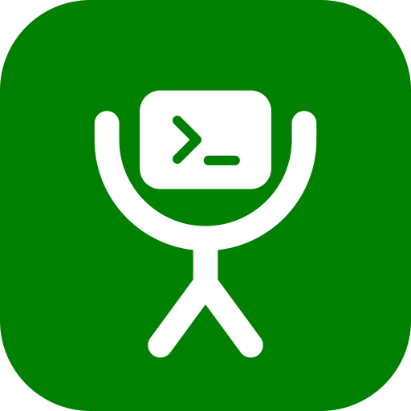

<div align="center">



# Glyph Rig

**Where your agents run: one Rig that names, connects and manages every harness across your Macs.**

Formerly Glyph Code. Same `glyph` command, same repo: `glyph update` keeps working.

`billing·acme-api·claude-code·mbp·2026-09-12·0556`

[](https://github.com/fru-dev3/glyph/stargazers)
[](LICENSE)

[Install](#install) · [Usage](#usage) · [Fleets](#fleets) · [glyph.fru.dev/rig](https://glyph.fru.dev/rig)

</div>

---

**Why now:** a year ago you ran one assistant in one terminal. Now agents run in
parallel, on machines you are not sitting at, and answer permission prompts on
your phone. Identity stopped being cosmetic.

Without a name, five running agents look like this:

```
rivers-macbook-pro-4-local-transient ← Claude Code, auto-derived
agent-5e                             ← Claude Code, auto-derived
doc-9b                               ← Claude Code, a different machine
zsh                                  ← Codex. no session name at all
node                                 ← Antigravity. same
```

- Two are the same project. You cannot tell which two.
- One is on a machine you are not sitting at.
- One has been idle since yesterday.
- Two are not named at all, because their agent has no such concept.

Turn glyph on and the same five read:

```
billing·acme-api·claude-code·laptop·2026-09-12·0556     ← MacBook Pro
migration·acme-api·agy·studio·2026-09-12·0602           ← Mac Studio
docs·website·codex·mini·2026-09-12·0611                ← Mac mini
audit·payments·claude-code·windows·2026-09-11·2247      ← Windows box, via WSL
scrape·atlas·codex·hetzner·2026-09-12·0640              ← cloud server
```

Label · project · agent · machine · date · time. Every field is lowercase; hyphens join words, and `·` separates fields. Every agent, every machine, set before
the first token.

**You could do this by hand.** Rename a Claude session with `/rename`, or
long-press it in the mobile app. glyph's argument is only that it happens
automatically:

- at launch, so a session is never briefly nameless
- on every agent, not just the one that supports naming
- on every machine, with the machine baked into the name
- with no step to forget and nothing to tidy up afterwards

It matters most when panes stop being distinguishable: several agents at once,
or [tmux](https://github.com/tmux/tmux), [herdr](https://herdr.dev) and
[workmux](https://github.com/raine/workmux) grids where every pane is a
lookalike shell.

## Install

```sh
git clone https://github.com/fru-dev3/glyph.git
cd glyph && source ./install.sh
```

One file into `~/.config/glyph/`, one line into `~/.zshrc`. zsh and at least one
agent CLI.

`source` matters. Run as `./install.sh` it is a child process, and a child
cannot define functions in the shell that started it, so you would have to
reload before glyph exists. Sourcing installs and loads in one step. If you
already ran it the other way, `. ~/.config/glyph/glyph.zsh` catches you up.

## Usage

Keep typing the command you already type. The rule is the same everywhere:

> **one bare word is your label. anything with a space is a prompt.**

### Claude Code

Claude is the one agent that can name its own session, so the mark becomes the
real session name and rides Remote Control to your phone.

```sh
claude
# launches:  claude -n 'acme-api·claude-code·mbp·2026-09-12·0648' --remote-control

claude billing
# launches:  claude -n 'billing·acme-api·claude-code·mbp·2026-09-12·0648' --remote-control

claude billing "fix the webhook retry"
# launches:  claude -n 'billing·…' --remote-control 'fix the webhook retry'
```

Open claude.ai/code or the phone app and that name is what you see in the list.

### Antigravity

`agy` has no session-name flag, so the label does not go into the command at
all. It goes on the terminal title, the tmux window and `glyph ls`:

```sh
agy migration
# launches:  agy
# titles:    migration·acme-api·agy·mbp·2026-09-12·0648
```

`GLYPH_YOLO=1` is separate from naming. Every agent has a flag meaning "stop
asking me to approve each tool call", and they all spell it differently. This is
one switch that sends the right one:

```sh
GLYPH_YOLO=1 agy migration
# launches:  agy --dangerously-skip-permissions
# titles:    migration·acme-api·agy·mbp·2026-09-12·0648
```

AGY requires an explicit flag for interactive prompts. Glyph supplies it:

```sh
agy billing "fix the retry"
# launches: agy --prompt-interactive 'fix the retry'
```

If `agy billing` reports an unexpected argument, the terminal may still have
an older wrapper loaded. Run `exec zsh` to reload the installed Glyph wrapper.
The mark appears in the terminal/tmux title and `glyph ls`, not AGY's app banner
or conversation name. Agents may overwrite terminal titles after launch; Fleet
keeps its own pane-border labels.

### Codex

Same shape, different spelling of the same flag:

```sh
codex audit
# launches:  codex
# titles:    audit·acme-api·codex·mbp·2026-09-12·0648

GLYPH_YOLO=1 codex audit
# launches:  codex --dangerously-bypass-approvals-and-sandbox

codex "refactor auth"
# launches:  codex 'refactor auth'
# a phrase is a prompt, so only the project is marked
```

### A session that is already open

Glyph names a session from argv, so one you started without it never got a
name. `glyph mark` applies everything Glyph can still reach from outside the
agent, and prints the one line only the agent itself can run:

```sh
glyph mark hotfix
# hotfix·acme-api·claude-code·mbp·2026-09-12·2107
#   set the terminal title
#   renamed the Herdr pane
#   recorded it in glyph ls
#
# this Claude session is still called 'fru-3e'
#
# an agent can only rename itself. paste this into it:
#   /rename hotfix·acme-api·claude-code·mbp·2026-09-12·2107
#   /remote-control
```

It reports only the surfaces it actually reached. Remote Control cannot be
switched on from outside the session, but Claude Code can do it from inside with
`/remote-control`, so Glyph offers that line whenever the bridge is off.

Glyph reads the agent out of the environment, which today means Claude Code.
From a plain shell, or beside an agent it cannot detect, the agent field reads
`shell` rather than going missing; name it properly with `glyph mark <label>
<agent>` or `GLYPH_AGENT`. Either way the mark keeps its shape, which is what
lets `glyph ps` line them up in a column.

### Everything else

```sh
glyph ls        # recent sessions: when, agent, mark, machine
glyph ps        # every agent session alive right now, named or not
glyph usage     # quota and token counts across agents
glyph wake      # continue sessions a usage limit stopped, at the reset
glyph spaces    # your workspaces and tabs per machine, built in Herdr
glyph doctor    # check the install and say what is wrong
glyph mark x    # name a session that is already open
glyph agents    # what is installed, and each one's auto-approve flag
glyph name x    # print the mark this directory would produce
glyph fleet ci  # a preset of agents, each in its own marked pane
glyph fleet report  # what this machine is: disks, memory, agents, accounts
glyph fleet status  # every machine side by side, with who is online
glyph fleet diff    # what is on one machine and not another
```

## Agents

| Agent | Carries the mark as | `GLYPH_YOLO=1` sends |
|---|:-:|---|
| Claude Code | real session name | `--dangerously-skip-permissions` |
| Antigravity (`agy`) | title | `--dangerously-skip-permissions` |
| Hermes | title | `--yolo` |
| omni | title | none |
| Codex | title | `--dangerously-bypass-approvals-and-sandbox` |
| Cursor | title | `--force` |
| Crush | title | `--yolo` |
| Cortex | title | `--dangerously-allow-all-tool-calls` |
| OpenCode | title | `--dangerously-skip-permissions`, on `opencode run` only (the TUI has no such flag) |
| pi | real session name | none |

Six agents, five spellings of *"stop asking me to approve every tool call"*.
`GLYPH_YOLO=1` sends whichever one is right. It is off unless you ask.

Tired of typing it? `export GLYPH_YOLO=1` in your `~/.zshrc` makes it the default
for every agent. That means every tool call runs without asking you, in every
project, which is exactly why glyph will not set it for you.

## Updating

```sh
glyph update   # fetch the latest glyph.zsh from GitHub, and load it here
glyph version
```

It loads the new file into the shell you ran it in, so there is nothing to
reload. Other shells you already have open keep the old one until `exec zsh`.

After an install or an update glyph asks, once, whether you would like to star
it on GitHub. Yes stars it through `gh` if you have it signed in, and prints
the link otherwise. Your answer is kept in `~/.local/state/glyph/star`, so the
question never comes back. It only asks at a terminal, and `GLYPH_STAR=0` turns
it off.

Refuses to install a file that does not parse, backs up the previous copy to
`~/.config/glyph/glyph.zsh.bak`, and never touches your config.

## Adding an agent

Any CLI, without waiting for a release. One tab-separated line per agent in
`~/.config/glyph/agents.tsv`:

```
openclaw	--yolo	OpenClaw
grok	--force	Grok
```

Columns are command, auto-approve flag, label. These merge over the built-ins,
so you can correct a flag too.

## Fleets

One preset launches several agents at once, each in its own marked pane:

```ini
# ~/.config/glyph/fleet.conf
solo   = claude                        # one agent, named
review = claude codex                  # two vendors on the same diff
duo    = claude agy                    # Anthropic and Google side by side
ci     = claude agy codex              # the three-up bench
bench  = claude codex agy cursor-agent # everything local
pair   = claude cursor-agent           # terminal agent + editor-native
deep   = claude cortex                 # coding agent + warehouse-native
light  = crush opencode                # cheap, quick passes
split  = claude codex:mini             # one local, one remote
spread = claude claude:mini            # same agent, two machines
cloud  = claude:mini codex:mini        # both on the remote box
```

```sh
glyph fleet init     # write the presets above, keeping any you already have
glyph presets        # list them
glyph fleet review   # launch one
```

Fleet on tmux is one session, one window, one tiled pane per slot. Glyph leaves
you in the first pane and turns the mouse on for that session so a click moves
between them (`ctrl-b o` and `ctrl-b` plus an arrow also work). Set
`GLYPH_FLEET_MOUSE=0` to leave the mouse alone.

### Usage and quota

```sh
glyph usage           # summary across agents
glyph usage codex     # both windows, plan, credits
glyph usage claude    # token counts for 5h and 7d
glyph usage --live    # the real percentages, from Anthropic
```

Codex writes its own rate limits to disk, so its 5h and weekly windows are
exact and offline. Claude does not: token counts come from your transcripts,
and the quota itself needs `--live`, which reads the Keychain token and asks
Anthropic. That is the only network request glyph makes besides `glyph update` and
the star you agree to.
AGY exposes nothing and is reported as such rather than guessed.

### Wake at the reset

Hit your Claude limit with four sessions open and they sit there until you come
back. Claude Code now continues a session by itself when the limit resets, with
two gaps: it will not wait when the reset is more than 24 hours away (the weekly
limit), and a Mac that slept through the reset wakes up to "press enter to
continue". `glyph wake` covers both.

```sh
glyph wake hook   # print the hook to add to ~/.claude/settings.json
glyph wake        # what is waiting, and the last few things it did
glyph wake cancel # stop waiting
```

When a session stops at the limit, a `StopFailure` hook records its pane. One
waiter per machine asks Anthropic (the same call as `glyph usage --live`) when
the limit lifts, sleeps until then, gives Claude Code two minutes to continue
on its own, and then looks at each session it parked:

- still open and untouched since the limit: it types `continue`
- showing "press enter to continue": it presses Enter
- already continued, or closed: it leaves it alone

It types into the pane, so the session has to be in Herdr or tmux and still
open. While it waits it keeps the Mac from idling to sleep (`caffeinate`); a
closed lid still sleeps, and `GLYPH_WAKE_AWAKE=0` lets it. A session that hits
the limit again right after three nudges is left for you. Codex has no hook,
so this is Claude only.

### Herdr plugin

Herdr shows which agents are running. It has no view of what is left to run
them with, so glyph ships one as a plugin:

```sh
herdr plugin install fru-dev3/glyph/herdr-plugin
```

An **Agent usage** pane with both Codex windows, Claude token counts and AGY
reported honestly as not exposed, plus an action to name the current pane.
Needs Herdr 0.7.4. See [herdr-plugin/](herdr-plugin/).

### Remote agents

A slot is `<agent>` or `<agent>:<machine>`. Glyph opens SSH in that pane, cds to
the same directory, and launches the agent through the remote wrapper so it gets
its own flags and its own mark.

`glyph hosts` lists everything you can put after the colon. A machine name
resolves in this order:

1. **SSH config**: a `Host` entry in `~/.ssh/config` always wins
2. **known_hosts**: a name SSH already trusts, so the pane never stalls on a
   fingerprint prompt
3. **Tailscale**: a short machine name is expanded to its MagicDNS name
4. **Literal**: anything else (`user@10.0.0.5`) goes to SSH untouched

Tailscale is optional and detected automatically. Accept a new host's key by
hand once (`ssh mini`) before using it in a fleet.

Remote slots work on **every** backend (Herdr, tmux, cmux, Zellij, WezTerm)
because they all build the same SSH command. Glyph is not tied to any one
workspace tool; with none running, Fleet falls back to tmux.

## Spaces

A fleet is a group you launch now. A space is the layout you come back to:
which workspaces and tabs a machine opens, which folder each tab sits in, and
which agent runs there. Written down once, it rebuilds a Herdr session after a
restart, and opens the same working set on a second machine, each tab resolved
to wherever that machine keeps the folder.

```sh
glyph spaces check    # resolve every tab on this machine; writes nothing
glyph spaces names    # the session name each tab's agent will answer to
glyph spaces apply    # build the workspaces and tabs in Herdr
glyph spaces start    # start agents in tabs that are still shells
glyph spaces remark   # rename running agents to their tab's name
```

The layout is yours, so it lives with your config and never in this repo:

```
~/.config/glyph/spaces/machines.json     each machine: its roots, tag, profiles
~/.config/glyph/spaces/spaces/*.json     each space: one workspace and its tabs
```

Point `GLYPH_SPACES` somewhere else, a synced folder for instance, and every
machine reads the same layout. [spaces/example](spaces/example/) shows the
shape, and [spaces/README.md](spaces/README.md) the details. Spaces is Python
and runs from a clone: `install.sh` links `glyph-spaces` into `~/.local/bin`.
Herdr is the only backend today.

## Fleet

A preset launches agents. The three commands below answer the other question:
what each of your machines actually is, and which one is free to take work.

```sh
glyph fleet report    # collect this machine and write it down
glyph fleet status    # every machine, side by side
glyph fleet diff      # the configuration that is not the same everywhere
```

`report` asks this Mac what it is: its model, chip, cores split performance and
efficiency, memory and swap, every mounted volume including the externals and
the network shares, which agents are installed and at which version, which
login each one is signed into, what is running right now, local inference
models, and a flat map of versions, MCP servers, skills and loaded services for
comparing against another machine. It writes one file per machine and appends a
line of history, so a trend exists later:

```
~/.config/glyph/rig/machines/<machine>.json
~/.config/glyph/rig/history/<YYYY-MM>.<machine>.jsonl
```

Point `GLYPH_RIG` at a synced folder, or link `~/.config/glyph/rig` to one, and
every machine's last reading is readable from any of them with no network call.

```sh
glyph fleet report --json    # print it instead, and write nothing
```

That form is what one machine runs on another: `ssh laptop
'~/.local/bin/glyph-fleet report --json'`. The path is spelled out because
`~/.local/bin` is not on a non-interactive PATH, and the collector is a file
rather than a shell function so that ssh can reach it at all. For the same
reason it looks for each agent in the folders agents install into, and does not
believe `command -v`.

`status` joins those readings to Tailscale, which is the only honest answer to
whether a machine is even on. A phone appears as a row with what Tailscale
knows and nothing more. `--machine <id>` prints one machine in full, every
volume and session included, and `--live` asks every reachable machine over ssh
first instead of reading the last file.

```
MACHINE          ROLE  UP   READING   CHIP         CORES  FREE MEM    BOOT DISK    LIVE
laptop           dev   yes  just now  Apple M2 Pro 6+4    5G of 17G   61% of 494G  3
studio           hub   yes  4m        Apple M4     4+6    1G of 17G   97% of 245G  9
bens-phone       -     yes  none      iOS          -      -           -            -
air              demo  no   21d       Apple M1     4+4    -           -            -
warning  studio           / is 97 percent full
offline  air              last seen 21d ago
```

`diff` prints only the keys that are not identical everywhere, with the odd
machine named, so a tool installed here and missing there is one glance:

```
KEY                                    laptop              studio
tool.uv                                0.8.5               0.8.8
tool.pi                                0.79.9              -                     only laptop
launchd.homebrew.mxcl.ollama           -                   loaded                only studio
```

Every reader stands on its own. One that cannot answer adds a line to `errors`
and the rest of the report still comes out, because losing a machine over one
unreadable fact is worse than saying what is missing. They all run at once, so
the slowest one is roughly how long the command takes: half a second on an idle
Mac, longer on one in the middle of a build. `GLYPH_FLEET_TIMEOUT=1` trades
detail for speed. Nothing is written outside the report folder, and an answer
that cannot change, a version or a model name, is kept in
`~/.local/state/glyph` rather than asked for again.

Fleet is Python beside Spaces, from the same clone: `install.sh` links
`glyph-fleet` into `~/.local/bin`.

<details>
<summary><b>Configuration</b></summary>

| Variable | Effect |
|---|---|
| `GLYPH_YOLO=1` | Auto-approve tool calls, per-agent flag |
| `GLYPH_OFF=1` | Keep the label, drop the machine and time |
| `GLYPH_FMT` | `date(1)` format for the stamp (default `%Y-%m-%d·%H%M`) |
| `GLYPH_SEP` | Separator (default `·`) |
| `GLYPH_ORDER` | Field order (default `label project agent machine stamp`); naming fewer leaves the rest out, and naming `account` adds the login |
| `GLYPH_ME` | Your first name, for splitting an address like `benwork4` (default: the computer's account name) |
| `GLYPH_ACCOUNTS` | Account tags that overrule the worked-out one (default `~/.config/glyph/accounts.tsv`) |
| `GLYPH_MACHINE` | Machine tag, when the hostname does not map well |
| `GLYPH_AGENT` | Agent for the mark, when Glyph cannot tell which one owns the shell |
| `GLYPH_AGENT_FALLBACK` | What to call a shell no agent owns (default `shell`) |
| `GLYPH_FLEET_BACKEND` | `auto` (Herdr, cmux, Zellij, WezTerm, then tmux), or an explicit backend |
| `GLYPH_RC=0` | Skip Claude's `--remote-control` |
| `GLYPH_TITLE=0` | Do not retitle the terminal or tmux window |
| `GLYPH_LOG=0` | Do not record sessions locally |
| `GLYPH_DRYRUN=1` | Print the argv instead of launching |
| `GLYPH_WAKE_AWAKE=0` | Let the Mac sleep while `glyph wake` waits |
| `GLYPH_WAKE_GRACE` | Seconds Claude Code gets to continue by itself first (default 120) |
| `GLYPH_SPACES` | Folder holding your spaces layout (default `~/.config/glyph/spaces`) |
| `GLYPH_SPACES_MACHINE` | Which machine in that layout this is, when the computer name does not match |
| `GLYPH_RIG` | Folder holding the fleet reports (default `~/.config/glyph/rig`) |
| `GLYPH_FLEET_TIMEOUT` | Seconds any one reader of `glyph fleet report` gets (default 2) |

**Machine tags** come from the system computer name when available. On macOS,
Glyph reads `scutil --get ComputerName`; Windows/WSL and Linux use the system
hostname. Every result is normalized to lowercase hyphenated form:

| System computer name | Tag |
|---|---|
| `Rivers MacBook Pro` | `rivers-macbook-pro` |
| `Studio Air` | `studio-air` |
| `DESKTOP-8KQ2LM1` | `desktop-8kq2lm1` |
| `ubuntu-prod-01` | `ubuntu-prod-01` |
| `hetzner-cx41` | `hetzner-cx41` |

Glyph does not guess a model or operating-system release. If the computer name
is missing or generic, or if you need a tablet/device role, set the tag yourself:

```sh
export GLYPH_MACHINE=windows-10   # or ipad, ubuntu-gpu, prod, laptop…
```

**Project names** are lowercase git repo directory tokens (`acme-api` stays
`acme-api`; `Acme API` becomes `acme-api`). Overrides in
`~/.config/glyph/names.tsv` are normalized the same way.

**Accounts.** With more than one Claude login, add `account` to `GLYPH_ORDER`
and the mark says which one the session started under. Glyph works the tag out
from the address: the initial of each word before the `@`, then its trailing
digits.

| Signed in as | Tag |
|---|---|
| `ben.carter4@example.com` | `bc4` |
| `benwork4@example.com` | `bw4` |
| `ben.carter@example.com` | `bc` |

`benwork4` has no dot to split on. When an address opens with your own first
name, as the computer has it, that name counts as the first word. Set
`GLYPH_ME` if the computer has it wrong, and `glyph account` prints the tag for
the current login. For an address the rule still gets wrong, one tab-separated
line in `~/.config/glyph/accounts.tsv` names the tag:

```
jsmith@example.com	work
```

Claude Code only, and the name is cut at launch: after a `/login` inside a
running session the old tag stays until the next launch.

`-p` / `--print` and subcommands (`claude mcp`, `codex resume`) pass through
untouched, so scripts and CI behave exactly as before.

</details>

<details>
<summary><b>Why a shell wrapper and not a plugin</b></summary>

A session name has to exist before the process starts, so it can only come from
argv. Plugins and `SessionStart` hooks run after that and cannot set it.

Two things that cost real debugging time:

- Claude Code's `--remote-control <name>` opens the bridge but does **not** name
  the session. It comes back as `nameSource: "derived"`. Only `-n` sets it, so
  glyph passes both. To see a session's real name, read
  `~/.claude/sessions/<pid>.json`; the startup banner shows neither.
- In zsh, `argv` **is** `$@`. Declaring `local -a argv` in a function silently
  empties the positional parameters.

glyph is an identity layer, not a multiplexer. Herdr is the recommended outer
workspace when you use it every day: launch `claude`, `codex`, or `agy` inside
an existing Herdr tab and Glyph labels that tab. `glyph fleet` currently creates
a standalone tmux session, so running it inside Herdr creates nested tmux. Use
Fleet outside Herdr, or keep using separate Herdr tabs until a native Herdr Fleet
backend is added.

</details>

## Part of Glyph

[Glyph](https://glyph.fru.dev): everything your AI agents need to work. Context compounds.

| Layer | | |
|---|---|---|
| 1 | [Glyph Studio](https://glyph.fru.dev/studio) | The environment your agents work in: one harness that builds and runs them. |
| 2 | [Glyph Jot](https://glyph.fru.dev/jot) | What you know: capture notes, ideas, decisions and meetings as your personal context. |
| 3 | [Glyph Ibis](https://glyph.fru.dev/ibis) | What the world knows: live data and outside knowledge for your agents, from 50+ context sources. |
| 4 | **Glyph Rig** (this repo) | Where your agents run: one Rig that names, connects and manages every harness across your Macs. |

Studio builds and runs a harness; the Rig connects and manages the harnesses across machines.
Plus two tools: Glyph Arena (Studio's lab) and Glyph Cast (screen videos, cleaned up).

## License

MIT
