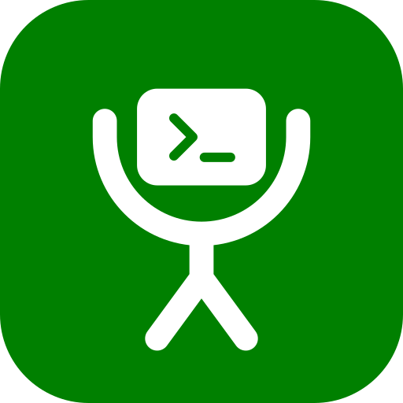

<div align="center">



# Glyph Rig

**Where your agents run: one Rig that names, connects and manages every harness across your Macs.**

Formerly Glyph Code. Same `glyph` command, same repo: `glyph update` keeps working.

`billing·acme-api·claude-code·mbp·2026-09-12·0556`

[](https://github.com/fru-dev3/glyph/stargazers)
[](LICENSE)

[Install](#install) · [Usage](#usage) · [Fleets](#fleets) · [Rig](#rig) · [glyph.fru.dev/rig](https://glyph.fru.dev/rig)

</div>

---

**Why now:** a year ago you ran one assistant in one terminal. Now agents run in
parallel, on machines you are not sitting at, and answer permission prompts on
your phone. Identity stopped being cosmetic.

Without a name, five running agents look like this:

```
rivers-macbook-pro-4-local-transient ← Claude Code, auto-derived
agent-5e                             ← Claude Code, auto-derived
doc-9b                               ← Claude Code, a different machine
zsh                                  ← Codex. no session name at all
node                                 ← Antigravity. same
```

- Two are the same project. You cannot tell which two.
- One is on a machine you are not sitting at.
- One has been idle since yesterday.
- Two are not named at all, because their agent has no such concept.

Turn glyph on and the same five read:

```
billing·acme-api·claude-code·laptop·2026-09-12·0556     ← MacBook Pro
migration·acme-api·agy·studio·2026-09-12·0602           ← Mac Studio
docs·website·codex·mini·2026-09-12·0611                ← Mac mini
audit·payments·claude-code·windows·2026-09-11·2247      ← Windows box, via WSL
scrape·atlas·codex·hetzner·2026-09-12·0640              ← cloud server
```

Label · project · agent · machine · date · time. Every field is lowercase; hyphens join words, and `·` separates fields. Every agent, every machine, set before
the first token.

**You could do this by hand.** Rename a Claude session with `/rename`, or
long-press it in the mobile app. glyph's argument is only that it happens
automatically:

- at launch, so a session is never briefly nameless
- on every agent, not just the one that supports naming
- on every machine, with the machine baked into the name
- with no step to forget and nothing to tidy up afterwards

It matters most when panes stop being distinguishable: several agents at once,
or [tmux](https://github.com/tmux/tmux), [herdr](https://herdr.dev) and
[workmux](https://github.com/raine/workmux) grids where every pane is a
lookalike shell.

## Install

```sh
git clone https://github.com/fru-dev3/glyph.git
cd glyph && source ./install.sh
```

One file into `~/.config/glyph/`, one line into `~/.zshrc`. zsh and at least one
agent CLI.

`source` matters. Run as `./install.sh` it is a child process, and a child
cannot define functions in the shell that started it, so you would have to
reload before glyph exists. Sourcing installs and loads in one step. If you
already ran it the other way, `. ~/.config/glyph/glyph.zsh` catches you up.

## Usage

Keep typing the command you already type. The rule is the same everywhere:

> **one bare word is your label. anything with a space is a prompt.**

### Claude Code

Claude is the one agent that can name its own session, so the mark becomes the
real session name and rides Remote Control to your phone.

```sh
claude
# launches:  claude -n 'acme-api·claude-code·mbp·2026-09-12·0648' --remote-control

claude billing
# launches:  claude -n 'billing·acme-api·claude-code·mbp·2026-09-12·0648' --remote-control

claude billing "fix the webhook retry"
# launches:  claude -n 'billing·…' --remote-control 'fix the webhook retry'
```

Open claude.ai/code or the phone app and that name is what you see in the list.

### Antigravity

`agy` has no session-name flag, so the label does not go into the command at
all. It goes on the terminal title, the tmux window and `glyph ls`:

```sh
agy migration
# launches:  agy
# titles:    migration·acme-api·agy·mbp·2026-09-12·0648
```

`GLYPH_YOLO=1` is separate from naming. Every agent has a flag meaning "stop
asking me to approve each tool call", and they all spell it differently. This is
one switch that sends the right one:

```sh
GLYPH_YOLO=1 agy migration
# launches:  agy --dangerously-skip-permissions
# titles:    migration·acme-api·agy·mbp·2026-09-12·0648
```

AGY requires an explicit flag for interactive prompts. Glyph supplies it:

```sh
agy billing "fix the retry"
# launches: agy --prompt-interactive 'fix the retry'
```

If `agy billing` reports an unexpected argument, the terminal may still have
an older wrapper loaded. Run `exec zsh` to reload the installed Glyph wrapper.
The mark appears in the terminal/tmux title and `glyph ls`, not AGY's app banner
or conversation name. Agents may overwrite terminal titles after launch; Fleet
keeps its own pane-border labels.

### Codex

Same shape, different spelling of the same flag:

```sh
codex audit
# launches:  codex
# titles:    audit·acme-api·codex·mbp·2026-09-12·0648

GLYPH_YOLO=1 codex audit
# launches:  codex --dangerously-bypass-approvals-and-sandbox

codex "refactor auth"
# launches:  codex 'refactor auth'
# a phrase is a prompt, so only the project is marked
```

### A session that is already open

Glyph names a session from argv, so one you started without it never got a
name. `glyph mark` applies everything Glyph can still reach from outside the
agent, and prints the one line only the agent itself can run:

```sh
glyph mark hotfix
# hotfix·acme-api·claude-code·mbp·2026-09-12·2107
#   set the terminal title
#   renamed the Herdr pane
#   recorded it in glyph ls
#
# this Claude session is still called 'fru-3e'
#
# an agent can only rename itself. paste this into it:
#   /rename hotfix·acme-api·claude-code·mbp·2026-09-12·2107
#   /remote-control
```

It reports only the surfaces it actually reached. Remote Control cannot be
switched on from outside the session, but Claude Code can do it from inside with
`/remote-control`, so Glyph offers that line whenever the bridge is off.

Glyph reads the agent out of the environment, which today means Claude Code.
From a plain shell, or beside an agent it cannot detect, the agent field reads
`shell` rather than going missing; name it properly with `glyph mark <label>
<agent>` or `GLYPH_AGENT`. Either way the mark keeps its shape, which is what
lets `glyph ps` line them up in a column.

### Everything else

```sh
glyph ls        # recent sessions: when, agent, mark, machine
glyph ps        # every agent session alive right now, named or not
glyph usage     # quota and token counts across agents
glyph wake      # continue sessions a usage limit stopped, at the reset
glyph spaces    # your workspaces and tabs per machine, built in Herdr
glyph doctor    # check the install and say what is wrong
glyph mark x    # name a session that is already open
glyph agents    # what is installed, and each one's auto-approve flag
glyph name x    # print the mark this directory would produce
glyph fleet ci  # a preset of agents, each in its own marked pane
glyph fleet report  # what this machine is: disks, memory, agents, accounts
glyph fleet status  # every machine side by side, with who is online
glyph fleet diff    # what is on one machine and not another
glyph rig plan      # what would change to make this machine able to work
glyph rig apps      # what the other machines have installed and this one does not
```

## Agents

| Agent | Carries the mark as | `GLYPH_YOLO=1` sends |
|---|:-:|---|
| Claude Code | real session name | `--dangerously-skip-permissions` |
| Antigravity (`agy`) | title | `--dangerously-skip-permissions` |
| Hermes | title | `--yolo` |
| omni | title | none |
| Codex | title | `--dangerously-bypass-approvals-and-sandbox` |
| Cursor | title | `--force` |
| Crush | title | `--yolo` |
| Cortex | title | `--dangerously-allow-all-tool-calls` |
| OpenCode | title | `--dangerously-skip-permissions`, on `opencode run` only (the TUI has no such flag) |
| pi | real session name | none |

Six agents, five spellings of *"stop asking me to approve every tool call"*.
`GLYPH_YOLO=1` sends whichever one is right. It is off unless you ask.

Tired of typing it? `export GLYPH_YOLO=1` in your `~/.zshrc` makes it the default
for every agent. That means every tool call runs without asking you, in every
project, which is exactly why glyph will not set it for you.

## Updating

```sh
glyph update   # fetch the latest glyph.zsh from GitHub, and load it here
glyph version
```

It loads the new file into the shell you ran it in, so there is nothing to
reload. Other shells you already have open keep the old one until `exec zsh`.

After an install or an update glyph asks, once, whether you would like to star
it on GitHub. Yes stars it through `gh` if you have it signed in, and prints
the link otherwise. Your answer is kept in `~/.local/state/glyph/star`, so the
question never comes back. It only asks at a terminal, and `GLYPH_STAR=0` turns
it off.

Refuses to install a file that does not parse, backs up the previous copy to
`~/.config/glyph/glyph.zsh.bak`, and never touches your config.

## Adding an agent

Any CLI, without waiting for a release. One tab-separated line per agent in
`~/.config/glyph/agents.tsv`:

```
openclaw	--yolo	OpenClaw
grok	--force	Grok
```

Columns are command, auto-approve flag, label. These merge over the built-ins,
so you can correct a flag too.

## Fleets

One preset launches several agents at once, each in its own marked pane:

```ini
# ~/.config/glyph/fleet.conf
solo   = claude                        # one agent, named
review = claude codex                  # two vendors on the same diff
duo    = claude agy                    # Anthropic and Google side by side
ci     = claude agy codex              # the three-up bench
bench  = claude codex agy cursor-agent # everything local
pair   = claude cursor-agent           # terminal agent + editor-native
deep   = claude cortex                 # coding agent + warehouse-native
light  = crush opencode                # cheap, quick passes
split  = claude codex:mini             # one local, one remote
spread = claude claude:mini            # same agent, two machines
cloud  = claude:mini codex:mini        # both on the remote box
```

```sh
glyph fleet init     # write the presets above, keeping any you already have
glyph presets        # list them
glyph fleet review   # launch one
```

Fleet on tmux is one session, one window, one tiled pane per slot. Glyph leaves
you in the first pane and turns the mouse on for that session so a click moves
between them (`ctrl-b o` and `ctrl-b` plus an arrow also work). Set
`GLYPH_FLEET_MOUSE=0` to leave the mouse alone.

### Usage and quota

```sh
glyph usage           # summary across agents
glyph usage codex     # both windows, plan, credits
glyph usage claude    # token counts for 5h and 7d
glyph usage --live    # the real percentages, from Anthropic
```

Codex writes its own rate limits to disk, so its 5h and weekly windows are
exact and offline. Claude does not: token counts come from your transcripts,
and the quota itself needs `--live`, which reads the Keychain token and asks
Anthropic. That is the only network request glyph makes besides `glyph update` and
the star you agree to.
AGY exposes nothing and is reported as such rather than guessed.

### Wake at the reset

Hit your Claude limit with four sessions open and they sit there until you come
back. Claude Code now continues a session by itself when the limit resets, with
two gaps: it will not wait when the reset is more than 24 hours away (the weekly
limit), and a Mac that slept through the reset wakes up to "press enter to
continue". `glyph wake` covers both.

```sh
glyph wake hook   # print the hook to add to ~/.claude/settings.json
glyph wake        # what is waiting, and the last few things it did
glyph wake cancel # stop waiting
```

When a session stops at the limit, a `StopFailure` hook records its pane. One
waiter per machine asks Anthropic (the same call as `glyph usage --live`) when
the limit lifts, sleeps until then, gives Claude Code two minutes to continue
on its own, and then looks at each session it parked:

- still open and untouched since the limit: it types `continue`
- showing "press enter to continue": it presses Enter
- already continued, or closed: it leaves it alone

It types into the pane, so the session has to be in Herdr or tmux and still
open. While it waits it keeps the Mac from idling to sleep (`caffeinate`); a
closed lid still sleeps, and `GLYPH_WAKE_AWAKE=0` lets it. A session that hits
the limit again right after three nudges is left for you. Codex has no hook,
so this is Claude only.

### Herdr plugin

Herdr shows which agents are running. It has no view of what is left to run
them with, so glyph ships one as a plugin:

```sh
herdr plugin install fru-dev3/glyph/herdr-plugin
```

An **Agent usage** pane with both Codex windows, Claude token counts and AGY
reported honestly as not exposed, plus an action to name the current pane.
Needs Herdr 0.7.4. See [herdr-plugin/](herdr-plugin/).

### Remote agents

A slot is `<agent>` or `<agent>:<machine>`. Glyph opens SSH in that pane, cds to
the same directory, and launches the agent through the remote wrapper so it gets
its own flags and its own mark.

`glyph hosts` lists everything you can put after the colon. A machine name
resolves in this order:

1. **SSH config**: a `Host` entry in `~/.ssh/config` always wins
2. **known_hosts**: a name SSH already trusts, so the pane never stalls on a
   fingerprint prompt
3. **Tailscale**: a short machine name is expanded to its MagicDNS name
4. **Literal**: anything else (`user@10.0.0.5`) goes to SSH untouched

Tailscale is optional and detected automatically. Accept a new host's key by
hand once (`ssh mini`) before using it in a fleet.

Remote slots work on **every** backend (Herdr, tmux, cmux, Zellij, WezTerm)
because they all build the same SSH command. Glyph is not tied to any one
workspace tool; with none running, Fleet falls back to tmux.

## Spaces

A fleet is a group you launch now. A space is the layout you come back to:
which workspaces and tabs a machine opens, which folder each tab sits in, and
which agent runs there. Written down once, it rebuilds a Herdr session after a
restart, and opens the same working set on a second machine, each tab resolved
to wherever that machine keeps the folder.

```sh
glyph spaces check    # resolve every tab on this machine; writes nothing
glyph spaces names    # the session name each tab's agent will answer to
glyph spaces apply    # build the workspaces and tabs in Herdr
glyph spaces start    # start agents in tabs that are still shells
glyph spaces remark   # rename running agents to their tab's name
```

The layout is yours, so it lives with your config and never in this repo:

```
~/.config/glyph/spaces/machines.json     each machine: its roots, tag, profiles
~/.config/glyph/spaces/spaces/*.json     each space: one workspace and its tabs
```

Point `GLYPH_SPACES` somewhere else, a synced folder for instance, and every
machine reads the same layout. [spaces/example](spaces/example/) shows the
shape, and [spaces/README.md](spaces/README.md) the details. Spaces is Python
and runs from a clone: `install.sh` links `glyph-spaces` into `~/.local/bin`.
Herdr is the only backend today.

### One space at a time

The four commands above are whole-machine: they answer for, or build, every
space this machine's profiles select. `--space` narrows a run to one, by its
id or by the workspace it builds:

```sh
glyph spaces check --space fru-dev-apps   # watch it resolve before building it
glyph spaces apply --space fru-dev-apps   # build that one and nothing else
glyph spaces start --space fru-dev-apps   # start its agents and no others
```

Every other workspace is left exactly as it was. A narrowed run does not
close, rename or write to a workspace it was not asked about, and `--prune` is
refused outright with `--space`, since pruning is about the workspaces this
machine does not take and that is every workspace the run was not named for.
An orphan, a workspace whose space file is no longer in the layout, is left
where it stands either way.

Name a space this machine's profiles do not select, or one that is not in the
layout at all, and the run refuses and prints the spaces this machine does
take. A refusal rather than a quiet nothing to do: a narrowed run that matched
nothing would print what a machine with everything already built prints, and
the difference between those two is a workspace nobody made.

## Fleet

A preset launches agents. The commands below answer the other question: what
each of your machines actually is, which one is free to take work, and which
one is switched on but cannot build anything.

```sh
glyph fleet report    # collect this machine and write it down
glyph fleet status    # every machine, side by side
glyph fleet diff      # the configuration that is not the same everywhere
glyph fleet setup     # what a machine still needs before it can do the work
```

`report` asks this Mac what it is: its model, chip, cores split performance and
efficiency, memory and swap, every mounted volume including the externals and
the network shares, which agents are installed and at which version, which
login each one is signed into, what is running right now, local inference
models, everything installed from Homebrew or sitting in `/Applications`, and a
flat map of versions, MCP servers, skills and loaded services for comparing
against another machine. It writes one file per machine and appends a line of
history, so a trend exists later:

```
~/.config/glyph/rig/machines/<machine>.json
~/.config/glyph/rig/history/<YYYY-MM>.<machine>.jsonl
```

Point `GLYPH_RIG` at a synced folder, or link `~/.config/glyph/rig` to one, and
every machine's last reading is readable from any of them with no network call.

```sh
glyph fleet report --json    # print it instead, and write nothing
```

That form is what one machine runs on another: `ssh laptop
'~/.local/bin/glyph-fleet report --json'`. The path is spelled out because
`~/.local/bin` is not on a non-interactive PATH, and the collector is a file
rather than a shell function so that ssh can reach it at all. For the same
reason it looks for each agent in the folders agents install into, and does not
believe `command -v`.

`status` joins those readings to Tailscale. A phone appears as a row with what
Tailscale knows and nothing more. `--machine <id>` prints one machine in full,
every volume and session included, and `--live` asks every Mac over ssh first
instead of reading the last file.

```
MACHINE          ROLE  UP   READING   CHIP         CORES  FREE MEM    BOOT DISK    LIVE  SETUP
laptop           dev   yes  just now  Apple M2 Pro 6+4    5G of 17G   61% of 494G  3     ok
studio           hub   yes  4m        Apple M4     4+6    1G of 17G   97% of 245G  9     4 bad
bens-phone       -     yes  none      iOS          -      -           -            -     -
air              demo  no   21d       Apple M1     4+4    -           -            -     unknown
can      laptop           vault swift-build mac-screen iphone-sim
can      studio           vault swift-build
reach    studio           roster says offline; it wrote a reading 4m ago
setup    studio           tcc.screen-recording   missing
setup    studio           signing.identity       broken
warning  studio           / is 97 percent full
offline  air              last seen 21d ago
```

### Up is a conclusion, not a flag

Tailscale's `Online` is the weakest evidence there is. It has reported a Mac
offline while an ssh session to its tailnet address was open, it had just
written a full report and nine agents were running on it: a direct LAN path
with no recent control-plane handshake leaves the flag stale while the machine
is perfectly reachable. So `UP` is decided by the best evidence there is. A
machine that answered this very command is up; so is one that wrote a reading
in the last few minutes (`GLYPH_FLEET_FRESH_S`); so is the machine you are
typing on. The flag is believed where there is nothing better, and `Online`
false with an old reading and no answer is down.

Where the conclusion and the flag disagree, a `reach` line says so. The column
is the answer and the line is the evidence it was reached on, rather than one
of the two quietly winning on a row that then contradicts the reading beside
it. `--live` asks every Mac whether the flag likes it or not, because a
machine skipped for being offline and then called offline on the strength of
the flag that skipped it is the one circle here worth closing; asking a
machine that really is off costs one connect timeout, in parallel with the
rest.

`SETUP` is `unknown` for a Mac that has never reported and blank for a row
that is not a Mac at all. The two looked the same in that column and they are
not the same thing.

`diff` prints only the keys that are not identical everywhere, with the odd
machine named, so a tool installed here and missing there is one glance:

```
KEY                                    laptop              studio
tool.uv                                0.8.5               0.8.8
tool.pi                                0.79.9              -                     only laptop
launchd.homebrew.mxcl.ollama           -                   loaded                only studio
```

### What it has installed

A new Mac is not missing a setting, it is missing two hundred things. So the
report carries an `installed` block: what is in the Cellar and the Caskroom,
what is in `/Applications` and `~/Applications`, and Herdr's own plugins.

```json
"installed": {
  "brew": "/opt/homebrew",
  "casks_known": 7823,
  "casks":    [ { "name": "obsidian", "version": "1.12.7", "asked": true } ],
  "formulae": [ { "name": "workmux", "version": "0.9.2",
                  "tap": "ben/workmux", "asked": true },
                { "name": "libpng",  "version": "1.6.50" } ],
  "apps":     [ { "id": "com.google.Chrome", "name": "Google Chrome",
                  "version": "156.0", "cask": "google-chrome" },
                { "id": "com.acme.notes", "name": "Acme Notes", "version": "0.23.3" } ],
  "herdr":    { "version": "0.9.5", "plugins": [ "Quick Select", "Spreader" ] }
}
```

| Field | |
|---|---|
| `asked` | installed by name, and nothing else installed depends on it |
| `tap` | the tap, left out for `homebrew/core` and `homebrew/cask` |
| `cask` | the cask that would install this app again, or absent |
| `casks_known` | how many casks Homebrew knows here, `null` when it has no index |

It is read off the disk. `brew list --versions` is a ruby start-up and seconds
of work; the two folders and each keg's own `INSTALL_RECEIPT.json` say the same
thing in twelve milliseconds, and the receipt says the thing that matters most
here: whether a formula was asked for. On this machine 132 of 193 formulae were
never asked for, and of the 61 that were, 11 are a dependency of another one
that was, so installing that brings them. 50 names is a list you recognise and
193 is a wall, which is why `asked` is brew's own `leaves --installed-on-request`
rather than everything in the Cellar.

The `cask` on an app is what could install it again, and it is the one guess in
the block. A cask brew recorded for a bundle it installed is certain. Otherwise
a cask of the same name counts, because a token is made from the app's own name,
so a Chrome nobody installed with brew is still one `brew install --cask
google-chrome` away. `Tailscale` misses `tailscale-app` and `zoom.us` misses
`zoom`, and a miss reads as a download, which is the direction that costs
nothing. A cask of that name installing something else would be the other
direction, and reading every cask's own app list to rule it out is `brew info`
once per app, which is minutes.

None of this goes into `glyph fleet diff`. Two hundred and fifty rows would
swamp a table meant to be read at a glance, and a version that changed this
morning is not a difference anyone acts on. `glyph rig apps` is where it lands.

**Herdr's plugins** come from `herdr plugin list --json`, the one
machine-readable list it has; it answers in milliseconds, starts no server and
needs none. Its integrations, the per-agent ones it installs for Claude, Codex,
pi and a dozen more, have `install` and `uninstall` and no `list`, so which of
those a machine has cannot be read. It is left out rather than guessed at. A
Herdr too old for `plugin list` leaves `plugins` null and a line in `errors`.

### Can it actually do the work

Online and useless is a real state. A Mac with 101 MB free, no Apple ID in
Xcode and a revoked signing certificate answers every question above and
cannot build a thing, and `UP yes` cannot tell it from one that can. So the
report carries a `setup` block: one named check per thing that has quietly
broken a build, each `ok`, `missing`, `broken` or `unknown`.

```sh
glyph fleet setup                    every machine, worst first
glyph fleet setup --machine studio   one of them
```

```json
"setup": {
  "ready": false,
  "checks": [
    { "id": "tcc.screen-recording", "state": "missing",
      "detail": "Screen Recording is not granted for the terminal, so a Mac screen check cannot pass",
      "proof": "CGPreflightScreenCaptureAccess() returns not granted",
      "human": "System Settings, Privacy and Security, Screen Recording, turn on the terminal",
      "fix": null }
  ]
}
```

The thirteen checks, worst first: `tcc.microphone`, `tcc.speech` and
`tcc.screen-recording`; `signing.identity`; `xcode.appleid`,
`xcode.devicesupport` and `xcode.developer-dir`; `disk.boot-free` and
`build.scratch`; `path.noninteractive`; `engine.version`; `locks`; and
`submodule.glyphcore`.

Three rules hold them up, and all three were paid for:

- **A check without a proof is not a check.** Every one carries the command
  whose failure it is reporting, so you can run it by hand and see the same
  thing. The signing check is why: `security find-identity -v` printed three
  valid identities on a Mac whose freshly built apps were being moved to the
  Trash, because macOS treats a revoked signature as malware and the error
  never says certificate. So that check signs a throwaway in a folder it makes
  and removes, runs `spctl -a -vvv -t exec` on it and reads the result for
  `CSSMERR_TP_CERT_REVOKED`. It is the only thing in the block that writes
  anything, and it does not run at all on a machine with no room.
- **`unknown` is never `ok`.** A check that cannot run, runs out of time or
  hits a permission wall says so and says why, and `ready` is false while any
  check is unknown. A held lock with no holder file is reported as unknown
  rather than assumed stale.
- **`human` and `fix` are different fields.** `human` is the clicks only a
  person can do, at that machine's own keyboard, and the three permissions are
  all of that: they cannot be granted from a shell at all, so each one names
  the exact System Settings path and offers no fix. `fix` is what could be
  automated later. Naming the clicks is the feature; implying they were
  handled would be the worst thing this could do.

Everything in the block reads. Nothing installs, grants, links, deletes,
points `DEVELOPER_DIR` or touches a keychain: `glyph fleet` says what a
machine is missing, and `glyph rig` is what does something about it.

### What it can therefore do

The checks say what is broken on a machine. They do not say what work it
can take, which is the half that makes placement possible: given a job that
needs a Swift build, which machines can have it. So the report carries a short
`capabilities` list beside them.

```json
"capabilities": [
  { "id": "vault",       "can": "yes",     "from": ["spaces.root.vault"] },
  { "id": "swift-build", "can": "no",      "from": ["xcode.developer-dir"] },
  { "id": "mac-screen",  "can": "unknown", "from": ["tcc.screen-recording"] },
  { "id": "iphone-sim",  "can": "yes",     "from": ["xcode.devicesupport",
                                                    "xcode.appleid"] }
]
```

| Capability | Yes when |
|---|---|
| `vault` | this machine's `vault` root is a folder that resolves here |
| `swift-build` | `xcode.developer-dir` names a full Xcode and `build.scratch` has room on the volume it writes to |
| `mac-screen` | `tcc.screen-recording` is granted, so a screen check can pass |
| `iphone-sim` | `xcode.devicesupport` has a version, and an Apple ID or an App Store Connect key is on disk |

Nothing is probed for these. Each one is read off checks that already ran in
the same report, so a capability costs nothing, cannot disagree with the check
it came from, and says nothing twice. `from` names the checks that decided it:
the ones that are not ok for a `no`, so a no leads back to a check with a
proof on it, and the ones that could not answer for an `unknown`. And
`unknown` is never `yes`, the same rule the checks keep, because a machine
that might be able to build is not one you hand a build to.

`glyph fleet status` prints a `can` line per machine, naming what it can do
with a `?` on what is not known; what it cannot do is the absence.
`glyph fleet setup` prints the table, with the checks each verdict came from:

```
CAPABILITY     CAN      FROM
vault          yes      spaces.root.vault
swift-build    yes      xcode.developer-dir, build.scratch
mac-screen     no       tcc.screen-recording
iphone-sim     no       xcode.appleid
```

Every reader stands on its own. One that cannot answer adds a line to `errors`
and the rest of the report still comes out, because losing a machine over one
unreadable fact is worse than saying what is missing. They all run at once, so
the slowest one is roughly how long the command takes: half a second on an idle
Mac, longer on one in the middle of a build. `GLYPH_FLEET_TIMEOUT=1` trades
detail for speed. Nothing is written outside the report folder, and an answer
that cannot change, a version or a model name, is kept in
`~/.local/state/glyph` rather than asked for again.

Fleet is Python beside Spaces, from the same clone: `install.sh` links
`glyph-fleet` into `~/.local/bin`.

### The one sign-in that clears three symptoms

No Apple ID in Xcode looks like three unrelated faults, and the third is the
one that wastes a day:

- `-allowProvisioningUpdates` has nothing to register a device with.
- An iPhone install cannot be signed.
- **A Mac app built on that machine dies about 14 ms after launch, with no
  crash report.** It reads as the app being broken. It is the signature.

The workaround while it is missing is to build ad-hoc, `SIGN_IDENTITY=-`. The
fix is one action at the keyboard: Xcode, Settings, Accounts, add the Apple ID.
`xcode.appleid` names it, and names your team when `GLYPH_TEAM` or a `team` in
the map says which one.

### Which account a machine can clone as

Two checks, because a status is not a capability. `gh auth status` has named
the right account while its token answered 401, `gh auth setup-git` has
finished while a clone still could not read a username, and the credential
helper has been configured correctly with a dead token behind it. Three green
signals and nothing worked. So `repo.access` asks the host who this machine is
and then lists a private repo, which exercises the token, the helper and the
repo's visibility in one go.

`repo.one-account` is the other half: a second identity on a machine agents
drive is a second chance to commit as the wrong one, and on a public repo that
is written into history for good. It reads the names out of the local config
and never a token.

Neither knows your account. Set them, or leave the checks saying so:

| Variable | |
|---|---|
| `GLYPH_GIT_ACCOUNT` | the one account this machine should answer as |
| `GLYPH_GIT_PROBE` | a private repo URL that only that account can list |

A `git` block in `machines.json` does the same for every machine at once.
Nothing is ever cached for long: a name and a successful listing are kept for
ten minutes, because this is the slowest reader in the report, and a failure
is never kept at all.

## Claims

Two agents can start the same piece of work. On one morning here, two of them
built the same feature in the same worktree and committed over each other, and
another built a feature that was already finished, because nothing told it so.
A claim is one session saying it has an area of work, so the next session that
reaches for that area is told who holds it and where.

```sh
glyph claim <area> [--branch <b>]   # take it, or hear who has it
glyph claims                        # who owns what right now, across machines
glyph release <area>                # give it back
```

```
AREA                   HOLDER                                         MACHINE        BRANCH           AGE       HELD
docs-rewrite           docs·acme-api·cc·laptop·261031-0914            laptop         -                2h        x
provisioning           rig·acme-api·codex·studio·261031-1010          studio         glyph-provision  12m       ?
ibis-funding           funding·acme-api·cc·laptop·261031-1021         laptop         glyph-claims     just now  ok
stale    docs-rewrite           docs·acme-api·cc·laptop·261031-0914 is gone
unknown  provisioning           no reading from studio since the claim
```

`ok` is held by a session that is running. `x` is stale: the session that took
it is gone, so the next `glyph claim` takes the area over and says whose it
was. `?` is unknown: either the holder cannot be read, or the machine holding
it has not reported since the claim was made. Unknown is never read as dead, so
it still blocks; `glyph release <area> --force` lets go of one once you have
looked at it.

An area is taken with `mkdir`, never a lock file. `mkdir` creates the directory
for exactly one caller and fails for every other, which is the whole of the
race. A plain file cannot do that at all, so a lock file is worse than nothing:
every waiter falls through and believes it won, which is what a 0-byte
`/tmp/glyph-mac-ui.lock` did here for a day. macOS has no `flock` either. The
holder is written into the directory on the next line, so the only moment a
claim exists without one is between those two lines, and a reader that lands
there says unknown rather than guessing.
[spaces/test_claims.py](spaces/test_claims.py) runs it rather than argues it:
eight processes reach for one area at the same instant, forty times over, and
exactly one may come away with it, twice over, since taking a stale claim from
its dead holder is its own race.

A shell that took a claim itself hands it back on the way out, a kill included,
so a closed terminal does not hold an area forever. A claim taken inside an
agent session belongs to the session rather than the shell, because each tool
call is a new shell; when that session goes, its claim reads as stale rather
than being released behind your back.

Claims live with your own config, never in this repo:

```
~/.config/glyph/claims/<area>.claim.d/holder
```

Point `GLYPH_CLAIMS` at a synced folder, or link `~/.config/glyph/claims` to
one, the way `GLYPH_SPACES` and `GLYPH_RIG` already work, and a claim taken on
one machine is readable on all of them with no network call. `glyph fleet
report` then carries the holder on the session row that has it:

```json
{ "name": "funding·acme-api·cc·laptop·261031-1021", "pid": 4821,
  "claim": { "area": "ibis-funding", "branch": "glyph-claims",
             "at": "2026-10-31T10:21:46-05:00" } }
```

That is why claims are part of Rig rather than a tool of their own: ownership
shows up beside the session actually doing the work, on every machine at once.

What a claim does not fix. It says nothing about a session reading a stale
branch, which is the other way two agents disagree about what is done. And it
is not the lock on a shared resource: the three `mkdir` locks that `glyph fleet
setup` reports under `locks` are still the answer for one machine's screen,
simulator and build output.
## Rig

`glyph fleet setup` says what a machine is missing. `glyph rig` does the part
of that which needs nobody at the keyboard.

```sh
glyph rig plan          # what would change here, and what only you can do
glyph rig apps          # what the other machines have installed and this one does not
glyph rig apply --yes   # do the automatable part
```

Every action is named for one of the checks. The plan is generated
from those checks as they answer right now, and the same check is what proves
the action worked afterwards, so there is nothing to keep in step and no
second list of what can go wrong.

```
bens-air  not ready, 10 of 13 checks

CHECK                 STATE    WOULD CHANGE                                      WHO
xcode.developer-dir   broken   DEVELOPER_DIR to /Volumes/studio/Xcode.app        rig
path.noninteractive   broken   3 folders onto the PATH in ~/.zshenv              rig
submodule.glyphcore   broken   GlyphCore copied into 2 of 3 checkouts            rig+you
tcc.microphone        missing  no shell can grant a permission                   you
tcc.speech            missing  no shell can grant a permission                   you
tcc.screen-recording  missing  no shell can grant a permission                   you
signing.identity      missing  nothing here touches a keychain                   you
xcode.appleid         missing  the key into ~/.appstoreconnect/private_keys      rig
xcode.devicesupport   missing  xcode.developer-dir covers the Xcode half         you
engine.version        missing  the engine installed, ~/.local/bin/prevail to it  rig
disk.boot-free        ok       -                                                 -
build.scratch         ok       build output to /Volumes/studio/glyph-build, 19   rig
locks                 ok       the 3 lock conventions into ~/.config/glyph/lock  rig

waiting  submodule.glyphcore  1 checkout has files but no Package.swift

only a person can do these, at the keyboard of bens-air:
  tcc.microphone         System Settings, Privacy and Security, Microphone, turn on the terminal
  tcc.speech             System Settings, Privacy and Security, Speech Recognition, turn on the terminal
  tcc.screen-recording   System Settings, Privacy and Security, Screen Recording, turn on the terminal
  xcode.devicesupport    attach the iPhone once and trust it

nothing was changed. glyph rig apply --yes does the 7 marked rig
```

And what `apply` prints is the same table with the state before, the state
after, and whether the check bore it out:

```
CHECK                 WAS      NOW      DID                                    RESULT
xcode.appleid         missing  ok       the key into ~/.appstoreconnect/pri    done
xcode.developer-dir   broken   ok       DEVELOPER_DIR to /Volumes/studio/Xc    done
build.scratch         ok       ok       build output to /Volumes/studio/gly    done
path.noninteractive   broken   ok       3 folders onto the PATH in ~/.zshenv   done
engine.version        missing  ok       the engine installed, ~/.local/bin/    done
locks                 ok       ok       the 3 lock conventions into ~/.conf    done
submodule.glyphcore   broken   broken   GlyphCore copied into 2 of 3 check     part

waiting  submodule.glyphcore  1 checkout has files but no Package.swift
undo     xcode.appleid        rm ~/.appstoreconnect/private_keys/AuthKey_ACME1234.p8
undo     xcode.developer-dir  take the lines between # >>> glyph rig >>> and # <<< glyph rig <<< out of ~/.zshenv
undo     build.scratch        rm ~/Library/Developer/Xcode/DerivedData
undo     engine.version       ln -sfn ~/src/engine/prevail ~/.local/bin/prevail

CHECK                WAS      NOW
xcode.appleid        missing  ok
xcode.developer-dir  broken   ok
path.noninteractive  broken   ok
engine.version       missing  ok

6 of 7 verified by their own checks: build.scratch, engine.version, locks, path.noninteractive, xcode.appleid, xcode.developer-dir
bens-air  not ready, 5 of 13 checks
```

`submodule.glyphcore` reads `part` rather than `done`, and the run exits 1,
because its check is still broken: one checkout had files in it and no
`Package.swift`, which is somebody's half-finished work, so nothing touched
it. The machine is still not ready afterwards, and the three permissions are
most of why.

The `WHO` column is the whole table in one word. `rig` is this command's work,
`you` is yours, `rig+you` is a row where some of it is automatable and the rest
is named beneath.

### What it can do

Eight actions, each one the automatable half of a check's own `fix`.

| Check | What the action does |
|---|---|
| `path.noninteractive` | Adds the installed folders to the PATH in `~/.zshenv`, the one file a non-interactive shell reads |
| `xcode.developer-dir` | Exports `DEVELOPER_DIR` for a full Xcode, wherever it lives, in the same file. Not `xcode-select -s`, which wants sudo and changes the machine for everything on it |
| `build.scratch` | Links Xcode's build folder and every Swift package's `.build` to a volume with room, so output lands off the boot disk with no flag to remember |
| `xcode.appleid` | Links the App Store Connect key where `xcodebuild` looks, which is how an iPhone install needs no interactive sign-in |
| `engine.version` | Installs the engine, and points the name on PATH at it where a stale build answers instead |
| `locks` | Writes the three lock conventions down, so every script on the machine agrees which path is which. It never takes a lock |
| `submodule.glyphcore` | Copies a healthy `Packages/GlyphCore` into a checkout that has none. A copy, never a link, which git refuses |
| `apps.missing` | Installs what the other machines have and this one does not, from Homebrew. Never a bundle copied off another Mac |

### What only you can do

This is not a gap to be closed later. Say it out loud rather than work around
it.

- **Microphone, Speech Recognition and Screen Recording.** No shell can grant
  a TCC permission. `xcrun simctl privacy ... grant speech-recognition`
  answers `Operation not permitted`. Each one names the exact System Settings
  path and whose permission it has to be, and it keeps the machine not ready
  however much else was fixed.
- **A revoked signing certificate.** Nothing here touches a keychain. The
  check finds the revocation and names it; deleting the wrong identity costs
  more than the broken build it was meant to fix.
- **An Apple ID in Xcode.** The App Store Connect key is the route that needs
  no sign-in, and the action wires it in. Signing in is still yours.
- **Freeing disk space**, which means deleting files somebody put there.
  `build.scratch` moves build output instead, which is the half that is safe.
- **Installing Xcode**, a download and a licence prompt.
- **`xcode-select -s`**, if you want `DEVELOPER_DIR` true for every process on
  the machine and not only for shells. The action writes it to `~/.zshenv`,
  which reaches every build a script or an agent starts, because those all
  come through a shell. A launchd job or an app that did not still reads
  `xcode-select -p`, and changing that wants sudo, so it is yours.
- **Attaching the iPhone once** and trusting it, so Xcode fetches support for
  its iOS version.
- **Signing in to anything.** Rig can put 1Password on a machine and must
  never read as having signed into it. Every app with an account is named,
  with the step, every time, and is never counted as done.
- **Downloading an app no cask knows.** It is named with where it came from,
  and a silent skip is what that is instead of.
- **Installing Homebrew**, which is a download piped into a shell, a password
  prompt and the Command Line Tools. The same class of thing as installing
  Xcode, so the check reports it as the blocker it is.

### Four rules

- **A step without a check is not done.** Every action is read back twice:
  each thing it says it wrote is looked for on the disk, and the check it is
  named for is asked again. `done` needs both. An action that ran and left its
  check broken reads `failed`, one that did part of the work reads `part`, and
  a check that will not answer reads `unknown`. Nothing is done on the
  strength of having run, because `git reset --hard` has printed a fatal
  error, exited 0, moved the working tree and left HEAD where it was.
- **Dry run is the default.** `plan` writes nothing. `apply` without `--yes`
  prints the plan, says so, and exits 2. One function both describes and does
  each action, so a plan cannot drift from what apply would run.
- **A human step is never counted.** Those permissions are printed apart from
  everything else, under their own line, because naming the clicks is the
  feature and implying they were handled is the worst thing this could do.
- **Nothing is made worse.** Every change prints how to reverse it. A file is
  copied to `<name>.glyph-rig.bak` before it is edited, and everything written
  to `~/.zshenv` goes between two markers, so deleting the block undoes it. A
  folder with output in it is left exactly as it is. A real file where a link
  should go is moved aside rather than thrown away. No keychain is touched and
  no lock another process holds is removed. At the end every check is read
  again, not only the ones that were touched, so an action that fixed its own
  check and broke another one is reported rather than missed.

### Where it runs

`plan` runs anywhere, including over ssh, because it writes nothing.
`plan --machine <id>` reads the reading that machine wrote and says which
checks this has an action for, without the steps: which volume, which Xcode
and which folders are facts about that machine's own disks, so they are worked
out there.

`apply` runs on the machine it is changing and refuses any other, over ssh or
otherwise. Changing PATH or `DEVELOPER_DIR` underneath work already running
somewhere else is the damage this exists to prevent.

### Everything a new Mac is missing

The fifteen checks are settings. This is the other half of setting a machine
up: the apps and tools your other machines already have.

```sh
glyph rig apps                  # what is missing here
glyph rig apps --machine air    # what is missing there, from the reading it wrote
glyph rig apps --all            # and what only some of them have
```

```
air  27 casks, 161 formulae, 27 apps, 22 herdr plugins, 149 missing against laptop and studio

WHAT                           KIND     ON    WHO     HOW
Google Docs                    app      2/2   you     no cask knows it, so download it from its own site
1password                      cask     2/2   rig     brew install --cask 1password
eza                            formula  2/2   rig     brew install eza
workmux                        formula  2/2   rig     brew install workmux

sign in  1password            open 1Password, sign in to the account, then turn on the browser extension and the CLI integration
sign in  google-chrome        open Chrome and sign in to the profile this machine uses

39 of the 42 every other machine has are installable from Homebrew; the rest is a download or an account
107 more that only some of them have: glyph rig apps --machine air --all
apply runs on the machine it changes: ssh air '~/.local/bin/glyph-fleet rig apply --yes'
```

A view of its own rather than a flag on `diff` or a section of `plan`, because
it is one question about one machine where both of those are tables about every
machine at once, and two hundred rows would swamp either.

**`ON` is how many of the others have it**, and the ones they all have come
first. That column is the difference between a baseline and somebody's
experiment: a name on every other machine is what a new Mac is missing, and a
name on one of three is a choice. Only the baseline is in the table by default,
only the baseline is what the check counts, and only the baseline is what
`apply` installs. `--all` prints the rest.

**Nothing here decides what you want installed.** The set is what your other
machines already have, read out of the readings they wrote, which is also why
this answers for a machine you are not sitting at. Narrow it with a list of
your own, the way `GLYPH_SPACES` and the `git` block already work:

| | |
|---|---|
| `GLYPH_INSTALL` | the names to care about, comma separated |
| `install` | the same, as a list beside `git` in `machines.json` |

With neither, every name the others have counts. The check this view belongs
to is `apps.missing`: `ok` when nothing the others all have is missing,
`broken` with no fix when there is no Homebrew to install anything with, and
`unknown` when nothing says what the machine should have, which is one machine
on its own with no list. It answers on the machine it runs on, so it needs the
other readings to be readable from there: point `GLYPH_RIG` at a synced folder,
or ask from a machine that has them all with `--machine`.

**`apply` installs from Homebrew and from nowhere else.** An app copied off
another Mac carries that machine's signature, its licence and its login, cannot
update itself, and macOS moves one it does not trust to the Trash on launch. So
the only thing that runs is the `brew install` you could have typed, and that
same line is the undo printed for it. Each one prints as it starts, because a
hundred installs is an hour and an hour of silence is indistinguishable from a
hang; nothing polls anything.

A run installs `GLYPH_INSTALL_MAX` of them, 20 by default, says how many are
left, reads `part` rather than `done`, and exits non-zero. Run it again and it
carries on. One command that then runs unattended for an hour is not something
to hand anybody, and a partial run that reported success would be worse.

### A new machine, end to end

```sh
glyph fleet report                   # a baseline before anything is done
glyph rig plan                       # what would change, and what is yours
glyph rig apps                       # what the others have and this does not
glyph rig apply --yes                # the automatable part, each step verified
glyph fleet setup                    # the checks again, from scratch
```

Take the baseline first, while the machine is still bare. It is the only
honest before, and without it there is no telling later what Rig did and what
was already true.

Then the human steps the plan named, at that keyboard, and then a real job
rather than a green check: a Swift build, a simulator test and a Mac screen
check. Anything you still had to do by hand is either a Rig gap worth fixing
or a human step worth writing down, and the difference has to be explicit.

Rig is the same Python as Fleet, from the same clone, and reaches the same
file: `install.sh` links `glyph-fleet` into `~/.local/bin`, so
`ssh laptop '~/.local/bin/glyph-fleet rig plan'` works as well as `glyph rig
plan` does.

<details>
<summary><b>Configuration</b></summary>

| Variable | Effect |
|---|---|
| `GLYPH_YOLO=1` | Auto-approve tool calls, per-agent flag |
| `GLYPH_OFF=1` | Keep the label, drop the machine and time |
| `GLYPH_FMT` | `date(1)` format for the stamp (default `%Y-%m-%d·%H%M`) |
| `GLYPH_SEP` | Separator (default `·`) |
| `GLYPH_ORDER` | Field order (default `label project agent machine stamp`); naming fewer leaves the rest out, and naming `account` adds the login |
| `GLYPH_ME` | Your first name, for splitting an address like `benwork4` (default: the computer's account name) |
| `GLYPH_ACCOUNTS` | Account tags that overrule the worked-out one (default `~/.config/glyph/accounts.tsv`) |
| `GLYPH_MACHINE` | Machine tag, when the hostname does not map well |
| `GLYPH_AGENT` | Agent for the mark, when Glyph cannot tell which one owns the shell |
| `GLYPH_AGENT_FALLBACK` | What to call a shell no agent owns (default `shell`) |
| `GLYPH_FLEET_BACKEND` | `auto` (Herdr, cmux, Zellij, WezTerm, then tmux), or an explicit backend |
| `GLYPH_RC=0` | Skip Claude's `--remote-control` |
| `GLYPH_TITLE=0` | Do not retitle the terminal or tmux window |
| `GLYPH_LOG=0` | Do not record sessions locally |
| `GLYPH_DRYRUN=1` | Print the argv instead of launching |
| `GLYPH_WAKE_AWAKE=0` | Let the Mac sleep while `glyph wake` waits |
| `GLYPH_WAKE_GRACE` | Seconds Claude Code gets to continue by itself first (default 120) |
| `GLYPH_SPACES` | Folder holding your spaces layout (default `~/.config/glyph/spaces`) |
| `GLYPH_SPACES_MACHINE` | Which machine in that layout this is, when the computer name does not match |
| `GLYPH_RIG` | Folder holding the fleet reports (default `~/.config/glyph/rig`) |
| `GLYPH_CLAIMS` | Folder holding the areas sessions have claimed (default `~/.config/glyph/claims`) |
| `GLYPH_FLEET_TIMEOUT` | Seconds any one reader of `glyph fleet report` gets (default 2) |
| `GLYPH_FLEET_DISK_FLOOR_GB` | Free space below which a build is reported broken (default 5) |
| `GLYPH_SIGN_IDENTITY` | The codesigning identity `signing.identity` verifies, by hash or name |
| `GLYPH_ENGINE` | Where the Glyph engine is (default `~/.local/lib/glyph/prevail`) |
| `GLYPH_GLYPHCORE` | Extra `Packages/GlyphCore` paths to check, colon separated |
| `GLYPH_BUILD_SCRATCH` | Where `glyph rig` puts build output; otherwise the roomiest volume that is not the boot disk |
| `GLYPH_ASC_KEY` | The `AuthKey_<id>.p8` to link where `xcodebuild` looks for it |
| `GLYPH_ASC_KEY_ID`, `GLYPH_ASC_ISSUER_ID` | The two ids a build needs beside that key |
| `GLYPH_ENGINE_SRC` | An engine binary to install from, on a machine with none |
| `GLYPH_GLYPHCORE_SRC` | A healthy `Packages/GlyphCore` to copy from |
| `GLYPH_INSTALL` | The names `glyph rig apps` cares about; otherwise every name the other machines have |
| `GLYPH_INSTALL_MAX` | How many `glyph rig apply` installs in one run (default 20) |
| `GLYPH_INSTALL_TIMEOUT` | Seconds one `brew install` gets (default 600) |

**Machine tags** come from the system computer name when available. On macOS,
Glyph reads `scutil --get ComputerName`; Windows/WSL and Linux use the system
hostname. Every result is normalized to lowercase hyphenated form:

| System computer name | Tag |
|---|---|
| `Rivers MacBook Pro` | `rivers-macbook-pro` |
| `Studio Air` | `studio-air` |
| `DESKTOP-8KQ2LM1` | `desktop-8kq2lm1` |
| `ubuntu-prod-01` | `ubuntu-prod-01` |
| `hetzner-cx41` | `hetzner-cx41` |

Glyph does not guess a model or operating-system release. If the computer name
is missing or generic, or if you need a tablet/device role, set the tag yourself:

```sh
export GLYPH_MACHINE=windows-10   # or ipad, ubuntu-gpu, prod, laptop…
```

**Project names** are lowercase git repo directory tokens (`acme-api` stays
`acme-api`; `Acme API` becomes `acme-api`). Overrides in
`~/.config/glyph/names.tsv` are normalized the same way.

**Accounts.** With more than one Claude login, add `account` to `GLYPH_ORDER`
and the mark says which one the session started under. Glyph works the tag out
from the address: the initial of each word before the `@`, then its trailing
digits.

| Signed in as | Tag |
|---|---|
| `ben.carter4@example.com` | `bc4` |
| `benwork4@example.com` | `bw4` |
| `ben.carter@example.com` | `bc` |

`benwork4` has no dot to split on. When an address opens with your own first
name, as the computer has it, that name counts as the first word. Set
`GLYPH_ME` if the computer has it wrong, and `glyph account` prints the tag for
the current login. For an address the rule still gets wrong, one tab-separated
line in `~/.config/glyph/accounts.tsv` names the tag:

```
jsmith@example.com	work
```

Claude Code only, and the name is cut at launch: after a `/login` inside a
running session the old tag stays until the next launch.

`-p` / `--print` and subcommands (`claude mcp`, `codex resume`) pass through
untouched, so scripts and CI behave exactly as before.

</details>

<details>
<summary><b>Why a shell wrapper and not a plugin</b></summary>

A session name has to exist before the process starts, so it can only come from
argv. Plugins and `SessionStart` hooks run after that and cannot set it.

Two things that cost real debugging time:

- Claude Code's `--remote-control <name>` opens the bridge but does **not** name
  the session. It comes back as `nameSource: "derived"`. Only `-n` sets it, so
  glyph passes both. To see a session's real name, read
  `~/.claude/sessions/<pid>.json`; the startup banner shows neither.
- In zsh, `argv` **is** `$@`. Declaring `local -a argv` in a function silently
  empties the positional parameters.

glyph is an identity layer, not a multiplexer. Herdr is the recommended outer
workspace when you use it every day: launch `claude`, `codex`, or `agy` inside
an existing Herdr tab and Glyph labels that tab. `glyph fleet` currently creates
a standalone tmux session, so running it inside Herdr creates nested tmux. Use
Fleet outside Herdr, or keep using separate Herdr tabs until a native Herdr Fleet
backend is added.

</details>

## Part of Glyph

[Glyph](https://glyph.fru.dev): everything your AI agents need to work. Context compounds.

| Layer | | |
|---|---|---|
| 1 | [Glyph Studio](https://glyph.fru.dev/studio) | The environment your agents work in: one harness that builds and runs them. |
| 2 | [Glyph Jot](https://glyph.fru.dev/jot) | What you know: capture notes, ideas, decisions and meetings as your personal context. |
| 3 | [Glyph Ibis](https://glyph.fru.dev/ibis) | What the world knows: live data and outside knowledge for your agents, from 50+ context sources. |
| 4 | **Glyph Rig** (this repo) | Where your agents run: one Rig that names, connects and manages every harness across your Macs. |

Studio builds and runs a harness; the Rig connects and manages the harnesses across machines.
Plus two tools: Glyph Arena (Studio's lab) and Glyph Cast (screen videos, cleaned up).

## License

MIT
